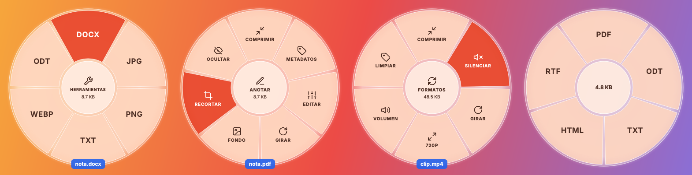

<p align="center"></p>

<h1 align="center">Mandarine</h1>

<p align="center"><b>Mantén Shift, arrastra, suelta. Listo.</b><br>
Una rueda que convierte y edita archivos mientras los arrastras, para Linux y Windows.</p>

<p align="center"></p>

Mantén **Shift** mientras arrastras un archivo y se abre una rueda alrededor del cursor. Suéltalo sobre un **formato** para convertirlo, o sobre una **herramienta** para comprimirlo, recortarlo, ocultar datos y más. El resultado se guarda junto al original y nunca se sobrescribe nada.

Todo ocurre en tu ordenador: ningún archivo se sube a internet. Es libre y gratuito (AGPL-3.0).

## Instalar

Todo se descarga desde [Releases](https://github.com/anrennnn/Mandarine-Linux-Windows/releases/latest).

### Windows 10 y 11

Ejecuta `Mandarine-Setup-<versión>.exe`. No pide permisos de administrador, y el asistente ofrece:

- añadir Mandarine al **clic derecho** del Explorador (en Windows 11, dentro de «Mostrar más opciones»);
- abrirla al iniciar sesión, que hace falta para **Shift + arrastrar**;
- instalar con `winget` **ffmpeg** (vídeo y audio), **LibreOffice** (Word, Excel, PowerPoint) y **Tesseract** (OCR).

El instalador no está firmado, así que SmartScreen puede avisar: «Más información» → «Ejecutar de todas formas». También hay una versión portable en `.zip`, y `mandarine-cli.exe` para usarla desde la terminal.

### Linux

```sh
sudo apt install ./mandarine_1.1.0_amd64.deb
```

`apt` instala también lo recomendado: **ffmpeg** (vídeo y audio), **LibreOffice Writer** (Word y documentos) y **Tesseract** (OCR en español e inglés). Si alguno falta, Mandarine te dice qué paquete instalar cuando lo necesitas.

Funciona en Debian 12 y 13, Ubuntu 22.04 o superior, Linux Mint 21 o superior, Pop!_OS, Zorin, elementary, MX y demás derivados de 64 bits (necesita glibc 2.34). El paquete trae su propio Python, así que no depende de la versión del sistema. Probado en Ubuntu 24.04.

Para desinstalar: `sudo apt remove mandarine`.

## Cómo se usa

| Cómo | Qué hace |
|---|---|
| **Shift + arrastrar** un archivo | Abre la rueda de **formatos** (X11: Cinnamon, MATE, XFCE, KDE/GNOME en X11) |
| **Ctrl + Shift + arrastrar** | Abre directamente la rueda de **herramientas** |
| Quedarte quieto sobre el **centro**, o **Tab** | Cambia entre formatos y herramientas |
| Soltar archivos en la **burbuja flotante** 🍊 | Abre la rueda en cualquier escritorio, también en **Wayland** |
| **Clic derecho → Mandarine** en el gestor de archivos | Nautilus, Dolphin, Nemo, Caja, Thunar y PCManFM |
| **Abrir con → Mandarine** | Desde cualquier gestor de archivos |
| **Ctrl + Alt + Espacio** | Abre la rueda (en GNOME Wayland, se configura con un botón en Ajustes) |
| `mandarine archivo.pdf` | Abre la rueda para ese archivo |

En **Windows**, Shift + arrastrar funciona con archivos que arrastras desde el Explorador o el escritorio, el atajo es el mismo (Ctrl + Alt + Espacio, y abre la rueda con lo que tengas seleccionado en el Explorador), y la burbuja también está disponible.

Con Shift, los gestores de archivos proponen **mover** el archivo; Mandarine siempre lo acepta como **copia**, así que el original nunca se toca.

### Formatos

| Archivo | Se convierte a |
|---|---|
| **PDF** | DOCX, JPG, PNG, TXT, WebP, ODT |
| **Imagen** (JPG, PNG, WebP, HEIC, AVIF, GIF, BMP, TIFF, ICO) | PDF, JPG, PNG, WebP, AVIF, HEIC, ICO, TXT (OCR) |
| **Documento** (DOCX, DOC, ODT, RTF, TXT, MD, HTML) | PDF, DOCX, ODT, TXT, HTML, RTF |
| **Hoja de cálculo** (XLSX, XLS, ODS, CSV) | PDF, XLSX, ODS, CSV |
| **Presentación** (PPTX, PPT, ODP) | PDF, PPTX, ODP, PNG |
| **Vídeo** (MP4, MOV, MKV, WebM, AVI…) | MP4, WebM, GIF, MP3, MOV, MKV |
| **Audio** (MP3, WAV, FLAC, OGG, M4A, Opus…) | MP3, M4A, WAV, OGG, FLAC, Opus |

Un PDF escaneado sin texto pasa por OCR automáticamente al convertirlo a TXT.

### Herramientas

| Tipo | Herramientas |
|---|---|
| **PDF e imágenes** | Comprimir · Recortar (con proporciones 1:1, 16:9, 9:16…) · Fondo (degradado, márgenes, esquinas, sombra) · Ocultar (borra de verdad el texto bajo el recuadro) · Editar (brillo, contraste, voltear, tamaño; separar páginas de un PDF) · Girar · Metadatos · Anotar · **Unir** varios en un PDF |
| **Vídeo** | Comprimir · Silenciar · Girar · Bajar a 720p · Ajustar volumen (-16 LUFS) · Limpiar metadatos |
| **Audio** | Comprimir · Ajustar volumen · Limpiar metadatos |

## Escritorios

| Escritorio | Shift + arrastrar | Burbuja | Clic derecho | Atajo global |
|---|---|---|---|---|
| GNOME (X11) | ✅ | ✅ | Nautilus ✅ | ✅ |
| GNOME (Wayland) | — | ✅ | Nautilus ✅ | ✅ con un clic en Ajustes |
| KDE Plasma (X11) | ✅ | ✅ | Dolphin ✅ | ✅ |
| KDE Plasma (Wayland) | — | ✅ | Dolphin ✅ | en Preferencias del sistema → Atajos: `mandarine wheel` |
| Cinnamon / MATE / XFCE / LXQt | ✅ | ✅ | Nemo / Caja / Thunar / PCManFM ✅ | ✅ |

| Windows 10 / 11 | ✅ (desde el Explorador) | ✅ | Explorador ✅ | ✅ |

Wayland no deja que ninguna app vea un arrastre en otra ventana: por eso existe la burbuja, que en Wayland viene activada por defecto. Para que la rueda y la burbuja puedan colocarse donde toca, Mandarine se ejecuta a través de XWayland.

## Línea de comandos

```sh
mandarine convert "Factura.pdf" --to docx
mandarine convert foto.heic --to jpg
mandarine convert escaneo.png --to txt        # OCR
mandarine convert video.mov --to mp4
mandarine compress video.mp4 --level high
mandarine mute video.mp4
mandarine resize video.mp4 --height 720
mandarine normalize podcast.wav
mandarine merge a.pdf b.pdf foto.jpg
mandarine targets archivo.pdf                 # a qué formatos se puede convertir
mandarine --help
```

## Desarrollo

```sh
sudo apt install python3-venv ffmpeg libreoffice-writer tesseract-ocr tesseract-ocr-spa \
  xvfb libxcb-cursor0 libegl1 libxkbcommon-x11-0
python3 -m venv .venv && .venv/bin/pip install -e ".[dev]"
.venv/bin/mandarine                      # arranca la app
xvfb-run -a .venv/bin/python -m pytest   # tests, con cobertura del 100 % obligatoria
./scripts/build-deb.sh                   # genera dist/mandarine_<versión>_amd64.deb
```

En Windows (PowerShell, con Python 3.12 e [Inno Setup 6](https://jrsoftware.org/isinfo.php)):

```powershell
py -3.12 -m venv .venv; .venv\Scripts\pip install -e ".[dev]"
.venv\Scripts\pyinstaller --noconfirm packaging\mandarine.spec      # dist\Mandarine\
iscc /DAppVersion=1.1.0 packaging\windows\mandarine.iss             # dist\Mandarine-Setup-1.1.0.exe
```

- `src/mandarine/ops/`: las operaciones sobre archivos, sin interfaz (PyMuPDF, Pillow, ffmpeg, LibreOffice, Tesseract).
- `src/mandarine/gui/`: la rueda, la burbuja, la bandeja, los diálogos y la integración con cada escritorio (`win32.py` para Windows).
- `src/mandarine/i18n.py`: textos en español (se usan si el sistema está en español; `MANDARINE_LANG=en` fuerza inglés).

Cada versión etiquetada (`v1.2.3`) compila el `.deb` y el instalador de Windows en GitHub Actions, los prueba y los publica en Releases. También puedes publicarla a mano: pestaña **Actions → CI → Run workflow**.

## Créditos y licencia

Mandarine parte de [Astral Shift](https://github.com/jtaoufik/astral-shift), de Taoufik Jabbari, y se inspira en el gesto de [Tangerine](https://tangerineformac.com/) para Mac, con la que no tiene relación. Licencia [GNU AGPL-3.0-or-later](LICENSE). El paquete incluye CPython (PSF), Qt for Python/PySide6 (LGPL-3.0), PyMuPDF (AGPL-3.0), Pillow (MIT-CMU), pillow-heif (BSD-3) y python-xlib (LGPL-2.1).
